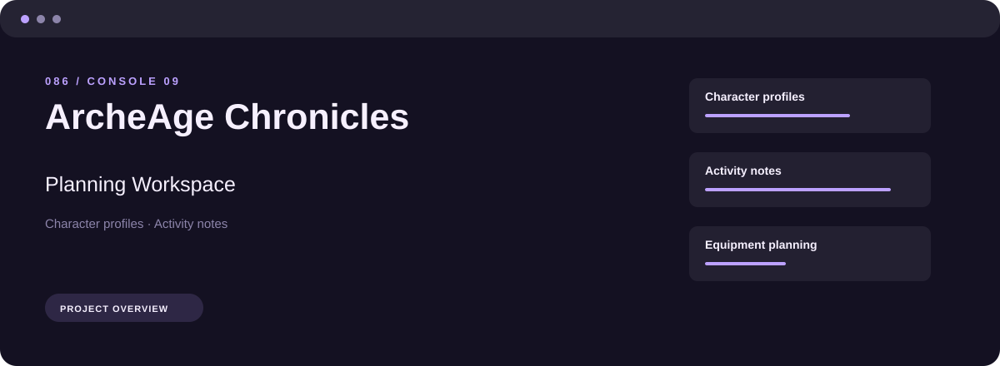
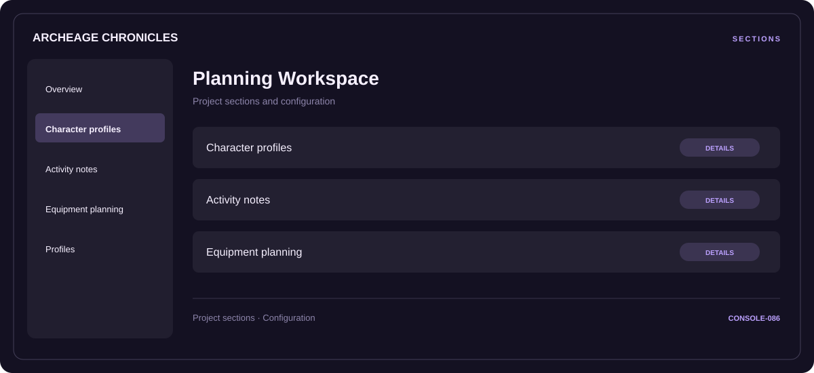

# ⚡ ArcheAge Chronicles Planning Workspace

**Character profiles · Activity notes · Equipment planning**

## ⚡ Features

Start with character profiles, organize activity notes, and keep equipment planning close at hand. These are the main areas covered by ArcheAge Chronicles Planning Workspace.

### ⚙️ Character profiles

Related settings collected into named groups for a clearer configuration workflow.

### 🧩 Activity notes

Session and activity information grouped by the task or context it belongs to.

### ⌨️ Equipment planning

Equipment categories and the associated selection or configuration options.

## 🖥️ Project navigation

## 📥 Download

The button and cover open the project's download page. Use the information supplied with the downloaded package for installation and release-specific requirements.

## 📚 Project documentation

- [Feature reference](docs/FEATURES.md)
- [Download information](docs/DOWNLOAD.md)
- [Project page](index.html)

---

ArcheAge Chronicles Planning Workspace · Program documentation and download information.
